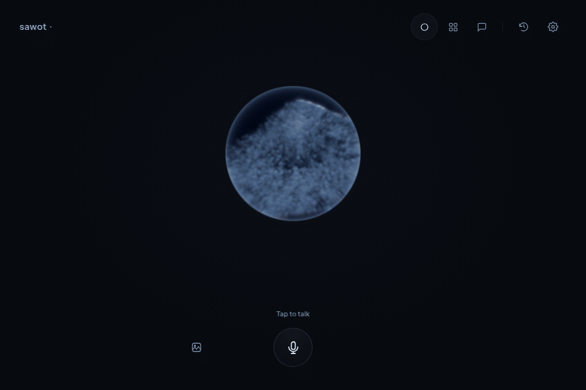
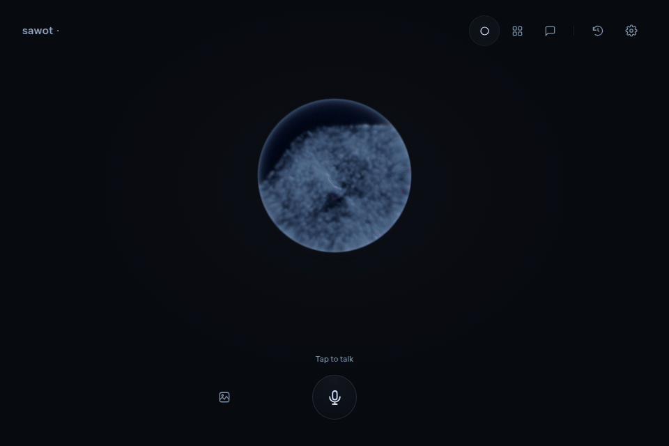
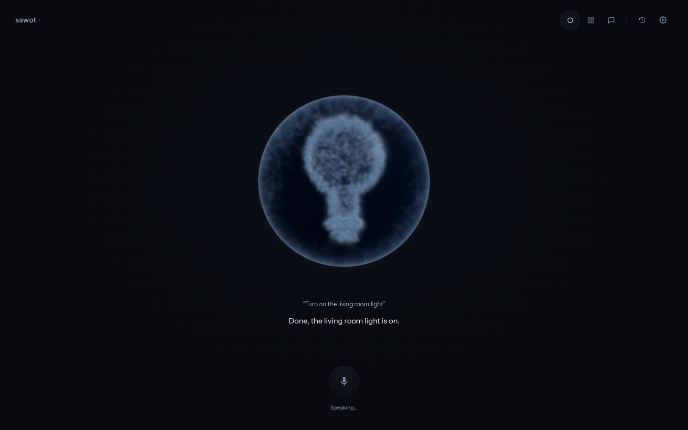
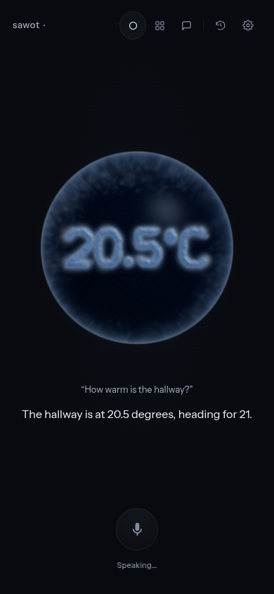
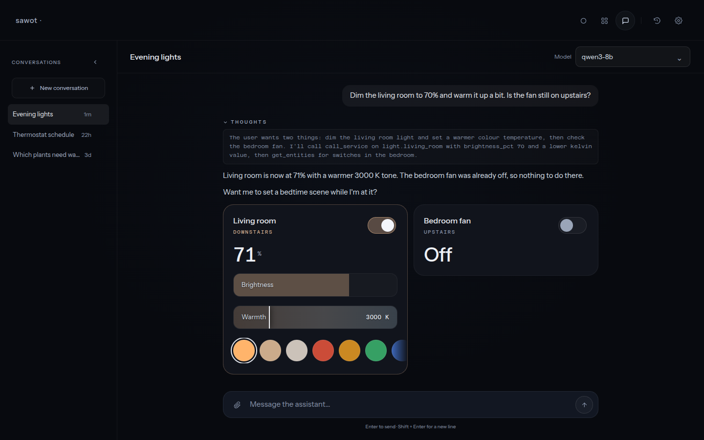
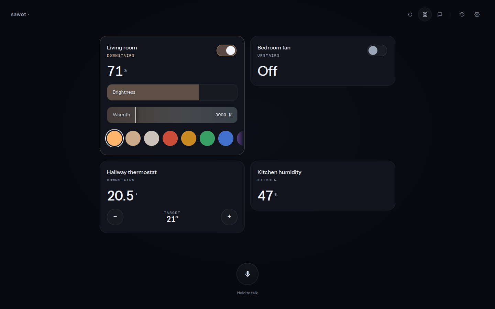
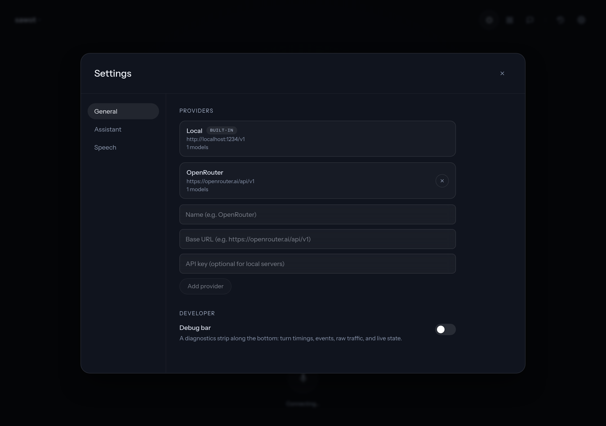
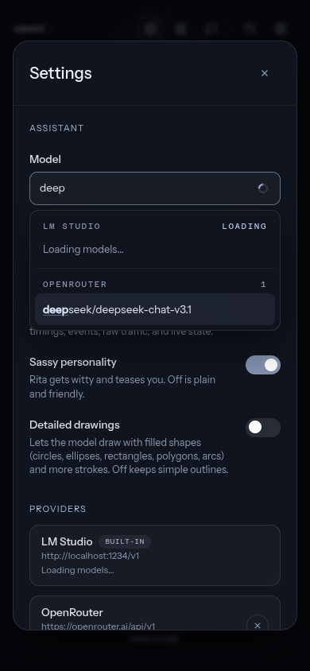
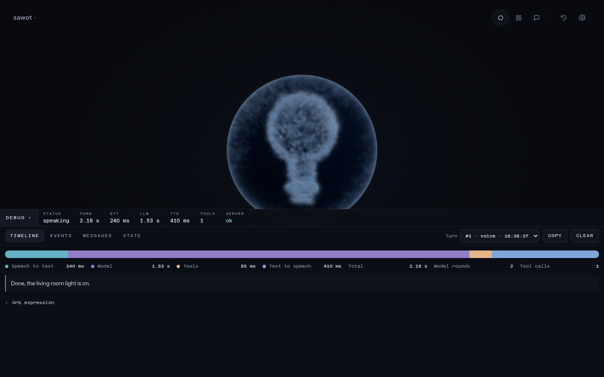

# Screenshot gallery

[← Back to SAWOT](../README.md)

## Animated demo

The README demo captures the current React interface and ink renderer in a
960 × 640 browser viewport. The 12-second loop at 20 frames per second shows listening, a request to
turn on the living room lights, thinking, a bulb expression during the reply,
and a return to listening. API and voice WebSocket connections are intercepted;
captions, activity, and audio levels are simulated. No microphone, speech model,
language model, or Home Assistant device is used. The GIF has no sound.

Capture initializes the browser clock before mounting the renderer and advances
it in fixed steps. Review the full sequence, including the transition back to
resting ink, when replacing this asset; switching clocks after mounting can
corrupt an otherwise valid-looking capture.

[Still image alternative](../screenshots/voice.png).

## General question and web search

This 16-second loop at 20 frames per second shows “When did the Roman Empire
collapse?”, web search and page-reading progress, a `476 AD` ink readout, the
answer, and the opened sources panel. The answer distinguishes the fall of the
Western Empire in 476 from the Eastern Empire’s survival until 1453, as described
by [World History Encyclopedia](https://www.worldhistory.org/Roman_Empire/) and
[The Metropolitan Museum of Art](https://www.metmuseum.org/de/essays/the-roman-empire-27-b-c-393-a-d).

The interface and ink animation are real; the question, answer, search events,
source list, and audio levels are scripted fixtures. The capture does not call
Brave, a language model, speech engines, or Home Assistant. Both source links
were checked separately when preparing the example. The GIF has no sound.

## Screenshots

These are existing UI captures. Some predate the current mobile composer,
voice-picture controls, and dictation button; their placement may differ from
this checkout. The redesign gallery includes simulated device and model
responses, not proof of live device control. See the
[visual notes](../screenshots/redesign/README.md) for capture context.

| Voice expression | Temperature readout on a phone |
| --- | --- |
|  |  |

**Chat with reasoning and inline device controls**

More screenshots: devices, speech settings, model picker, and diagnostics

**Devices** — cards for the entities involved in the conversation.

**Speech settings** — engine selection, voices, and voice cloning.

**Model picker on a phone** — searchable models grouped by provider.

**Diagnostics** — a turn timeline and orb-expression details.

